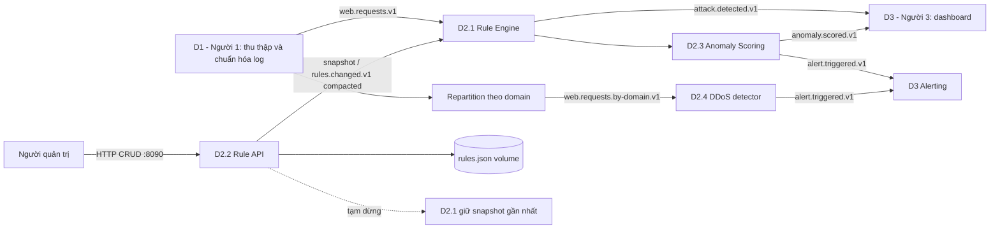
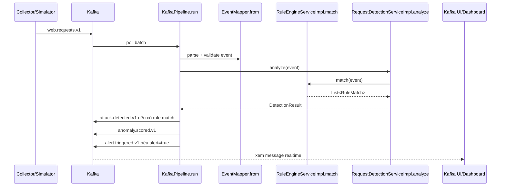

# WAF Detection Engine (Java 17)

Đây là phần Detection Engine của hệ thống phân tích WAF log. Service nhận request đã chuẩn hóa từ Kafka, phát hiện SQL Injection, XSS, path traversal, chấm điểm bất thường và phát cảnh báo gần thời gian thực.

## Kiến trúc đề xuất

Một codebase và một Docker image được chạy dưới bốn role độc lập:

| Role | Module | Trách nhiệm |
|---|---|---|
| `detection` | D2.1 + D2.3 | Match rule, thống kê cửa sổ theo client, chấm điểm và phát cảnh báo |
| `rule-management` | D2.2 | CRUD, validate, lưu rule và phát snapshot cấu hình |
| `repartition` | hỗ trợ DDoS | Đổi Kafka key từ client sang domain |
| `ddos` | D2.4 | Phát hiện burst phân tán theo domain |



### Vì sao chọn kiến trúc này

D2.1 Rule Engine và D2.3 request scoring nằm cùng process vì chúng cùng xử lý một event và cùng dùng cửa sổ trạng thái theo client. Cách này tránh thêm một lần serialize, network hop và consumer lag ở đường xử lý nóng. Chúng vẫn được tách qua interface/service để có thể tách thành process riêng sau này nếu tải yêu cầu.

D2.2 Rule API là control plane bên trong Detection Engine, không nằm trên đường xử lý request. Nó lưu snapshot vào JSON volume rồi phát toàn bộ snapshot lên topic compacted. D2.1 biên dịch snapshot mới trước, sau đó thay danh sách rule bằng một phép gán nguyên tử. Một rule lỗi không làm hỏng snapshot đang hoạt động.

### Ưu điểm

- Toàn bộ D2 phát triển và test độc lập với D1/D3 thông qua Kafka contract.
- D2.1 vẫn phát hiện khi D2.2 Rule API tạm dừng; không gọi HTTP cho từng request.
- RE2/J đảm bảo thời gian regex tuyến tính và từ chối backreference/lookaround không được hỗ trợ, tránh catastrophic backtracking.
- Rule nằm trong YAML/JSON, được validate schema và biên dịch một lần khi cập nhật.
- Topic đầu ra tách theo mục đích, giúp dashboard và alert consumer không phải lọc một topic tổng hợp.
- Topic rule dạng compacted giữ snapshot mới nhất để instance D2.1 mới có thể khôi phục.
- Một image cho bốn role giúp build/version đồng nhất, trong khi Compose vẫn scale từng role riêng.

### Nhược điểm và giới hạn

- D2.1 + D2.3 chung process nên chưa thể scale hai bước với tỷ lệ khác nhau.
- JSON volume phù hợp đồ án và một instance D2.2. Nhiều instance Rule API cần PostgreSQL và cơ chế version/optimistic locking.
- State cửa sổ hành vi đang ở RAM; restart làm mất cửa sổ ngắn hạn. Khi cần state bền vững qua rebalance nên chuyển D2.3 sang Kafka Streams/RocksDB.
- Kafka cung cấp at-least-once; consumer phía dashboard nên khử trùng theo `event_id`.
- RE2 không hỗ trợ một số cú pháp PCRE nâng cao. Rule phải dùng tập regex tương thích RE2.

## Toàn bộ D2 có phát triển độc lập được không?

**Có.** Repository này chính là toàn bộ D2 Detection Engine và chỉ phụ thuộc các contract ổn định:

1. Input `web.requests.v1` do D1 phát ra theo schema `Event`.
2. Output `attack.detected.v1`, `anomaly.scored.v1`, `alert.triggered.v1` cho D3.
3. `RuleDefinition`/`RuleDocument` và `rules.changed.v1` là contract nội bộ giữa D2.2 và D2.1.

D2 không gọi trực tiếp mã nguồn của D1 hoặc D3. Khi phát triển chưa có D1, có thể dùng simulator phát event mẫu; khi chưa có D3, xem output bằng Kafka UI. Riêng D2.2 có thể chạy Kafka + `rule-api` để test CRUD. Repository nằm sau `RuleStoreService`, nên có thể thay JSON bằng PostgreSQL mà không đổi API hoặc D2.1.

## Pipeline thực thi và class/method



| Bước | Class/method | Logic |
|---|---|---|
| Khởi động | `App.main()` | Chọn role từ argument hoặc `DETECTOR_ROLE` |
| Nhận event | `KafkaPipeline.run()` | Poll batch, kiểm tra Kafka key, gửi output rồi mới commit offset |
| Chuẩn hóa input | `EventMapper.from()` | Kiểm tra schema, timestamp, headers và giới hạn kích thước |
| Match rule | `RuleEngineServiceImpl.match()` | Chuẩn hóa từng field, chạy RE2 trên URL/query/body/headers |
| Hot reload | `RuleChangeSubscriber.consume()` → `replaceRules()` | Đọc snapshot compacted, validate/compile rồi thay rule nguyên tử |
| Chấm điểm | `RequestDetectionServiceImpl.analyze()` | Kết hợp rule score, request rate, error rate, distinct path và cooldown |
| CRUD D2.2 | `RuleApiServer.rules()` | GET/POST/PUT/DELETE và validate rule |
| Lưu rule | `RuleStoreServiceImpl.save/delete()` | Ghi file tạm rồi atomic move sang `rules.json` |
| Phát rule | `KafkaRuleChangePublisher.publish()` | Gửi full snapshot với key `active` |

## Cấu trúc mã nguồn

```text
src/main/java/com/example/waf/detector/
├── api/                 # HTTP entry point của D2.2 Rule Management
├── config/              # Cấu hình và threshold
├── enums/               # Role chạy ứng dụng
├── kafka/               # Pipeline, rule publisher/subscriber
├── model/               # Event, rule và detection objects
├── service/             # Interface nghiệp vụ
├── service/impl/        # Logic triển khai
└── util/                # Mapper, normalizer, đọc environment
src/main/resources/rules/default-rules.yaml
```

## Database

D2.2 cần persistence để rule không mất sau restart, nhưng hiện chưa cần dựng database server. `rules-data` Docker volume lưu `rules.json` theo cách atomic, đủ cho một instance và khối lượng rule nhỏ. Kafka lưu snapshot phân phối tới D2.1, không thay thế nguồn dữ liệu quản trị của D2.2.

Chuyển sang PostgreSQL khi cần nhiều instance D2.2, audit lịch sử, phân quyền chỉnh sửa, rollback theo version hoặc cập nhật đồng thời. Dữ liệu event dài hạn dành cho dashboard nên do D3 lưu vào PostgreSQL/ClickHouse/Elasticsearch, không ghi từng request vào database quản lý rule.

## Chạy hệ thống

```bash
docker compose up --build -d
docker compose ps
```

Simulator chỉ chạy khi bật profile `simulation`:

```bash
docker compose --profile simulation up --build -d
```

`SIM_DURATION=0` trong `.env` nghĩa là simulator chạy liên tục. Đặt số giây khác rồi khởi động lại nếu muốn tự dừng.

Chỉ phát triển D2.2 Rule API:

```bash
docker compose up -d kafka kafka-init rule-api kafka-ui
curl http://localhost:8090/health
curl http://localhost:8090/api/rules
```

Ví dụ validate một rule mà chưa lưu:

```bash
curl -X POST http://localhost:8090/api/rules/validate \\
  -H "Content-Type: application/json" \\
  -d '{"id":"XSS_IFRAME","group":"XSS","description":"iframe injection","enabled":true,"targets":["body"],"pattern":"<[ ]*iframe","score":75,"normalizers":["url_decode","html_decode"]}'
```

POST cùng JSON vào `/api/rules` để tạo; PUT `/api/rules/{id}` để cập nhật; DELETE `/api/rules/{id}` để xóa.

## Theo dõi realtime bằng UI

Mở [Kafka UI](http://localhost:8080), chọn cluster `waf-local` → **Topics** → chọn một topic → **Messages** → chọn chế độ live/tự refresh:

- `web.requests.v1`: request đầu vào.
- `attack.detected.v1`: D2.1 đã match SQLi/XSS/path traversal.
- `anomaly.scored.v1`: mọi kết quả chấm điểm được phép xuất.
- `alert.triggered.v1`: cảnh báo cần Người 3 xử lý.
- `rules.changed.v1`: snapshot rule D2.2 vừa phát.
- `security.invalid.v1`: event sai schema/contract.

Theo dõi log container:

```bash
docker compose logs -f rule-api detector
docker compose logs -f simulator
```

## Kiểm thử

```bash
mvn test
docker compose config --quiet
```

Test bao phủ encoding/SQL comment, XSS/path traversal, header matching, RE2 validation, event time, cooldown và DDoS threshold. Hướng dẫn vận hành chi tiết hơn nằm tại [`docs/RUNBOOK.md`](docs/RUNBOOK.md).
